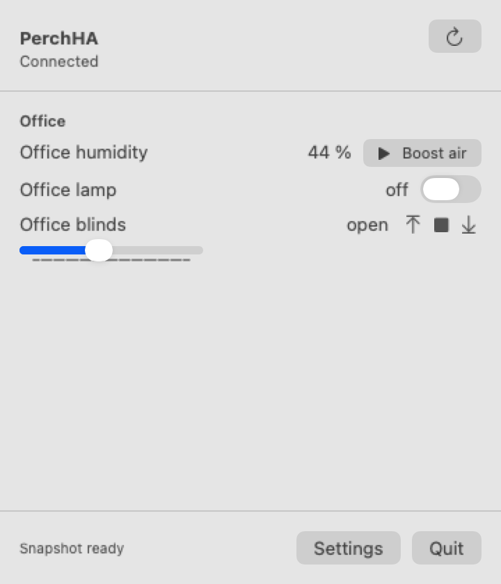
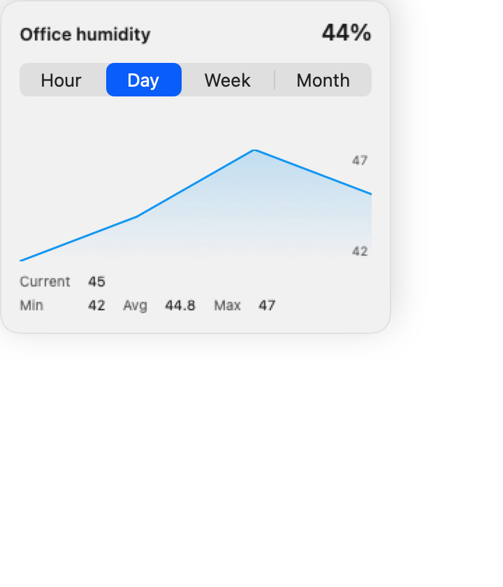
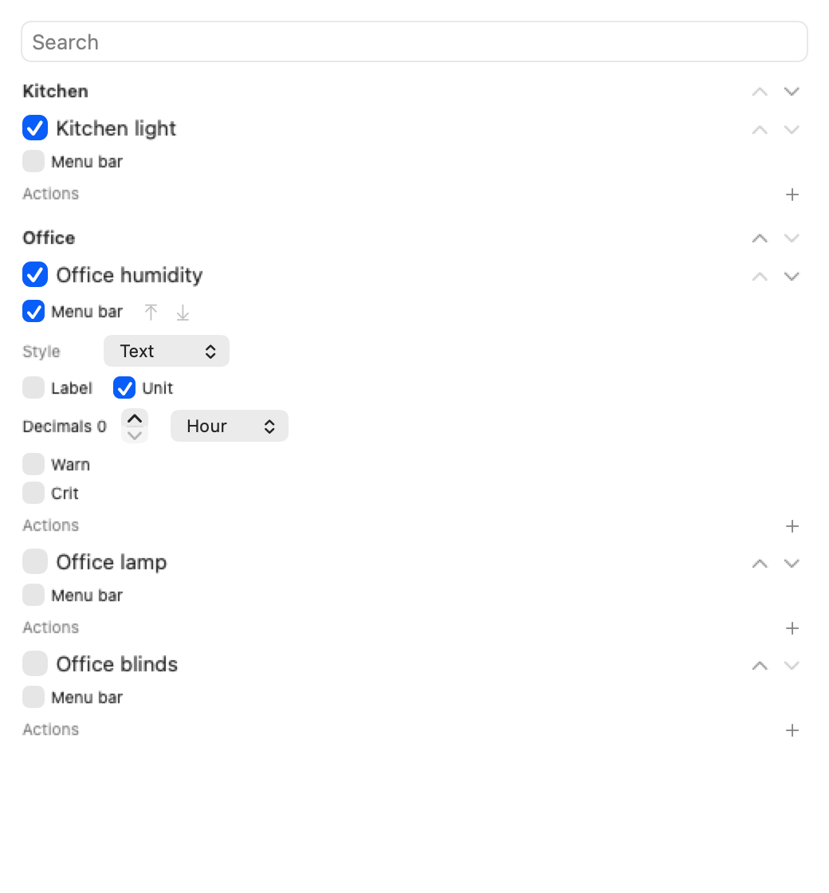

# PearchHA

A native macOS menu bar app for Home Assistant.

[](https://github.com/YunaBraska/pearch_ha/actions/workflows/build-pr.yml)
[](LICENSE)
[](https://developer.apple.com/macos/)

| Drop-down panel | History detail | Settings |
| --- | --- | --- |
|  |  |  |

## Features

- Configurable menu bar values and gauges, with a panel grouped by room.
- Optional live updates while the panel is open, or cheaper timed refreshes.
- History previews and on-demand detail for hour, day, week, and month.
- Capability-derived native controls and custom Home Assistant service actions.
  See the [supported domains](docs/HA_API.md#domains).
- Per-entity icons, units, thresholds, chart ranges, linked averages, and layout.
- Browser sign-in or token auth, Keychain session restore, and address fallback.

## Requirements

- macOS 13 or newer.
- A reachable Home Assistant instance.

## Run it

With Xcode:

```sh
open PearchHA.xcodeproj
```

For command-line builds, signing, and contributions, see [CONTRIBUTING.md](CONTRIBUTING.md).
Run `sh scripts/check.sh` for the complete local verification contract.

## Documentation

The [documentation index](docs/README.md) links architecture, API behavior, decisions,
verification, and the remaining release work.

## Repo layout

```text
pearch_ha/
|- Package.swift
|- PearchHA.xcodeproj
|- Sources/
|- Tests/
|- Fixtures/
`- docs/
```
